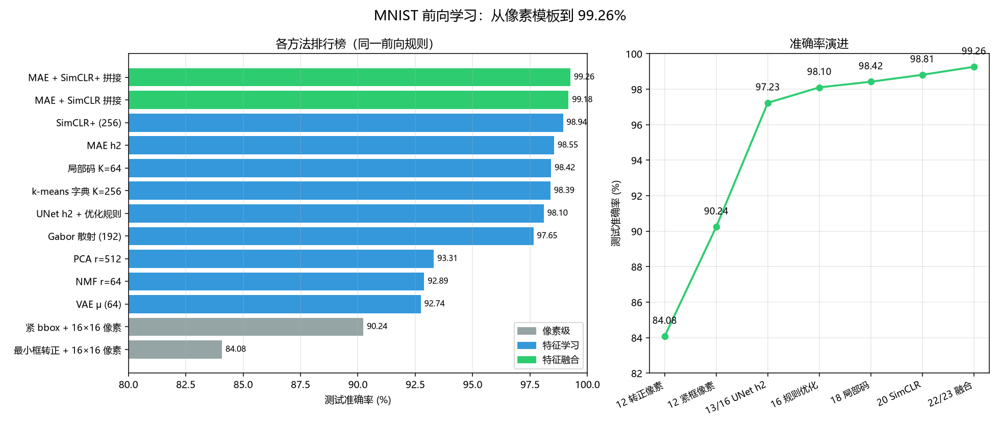

# 探索前向学习的一种方案

## 目标

探究一种无反的，可实时学习的一种可能性（以MNIST数据为例）。

根据实验结果，个人认为，只要存在一个能够分得清的基础模型（基础感知），那么在下游任务上，实时的前向学习方法就是存在的。



## 结果总览

| 文件 | 说明 |
|---|---|
| [`final.py`](final.py) | 自包含的最终管线：bbox → MAE h2 + SimCLR → 逐块 L2 拼接 → 优化后的前向规则；测试 99.26% |
| [`report.md`](report.md) | 全部实验的总结：最终方案、演进路线、8 条主要结论、代码索引、局限 |
| [`summary.py`](summary.py) / [`summary.png`](summary.png) | 排行榜与准确率演进图 |
| `runs/final/` | 最终方案的数值（`summary.json`）、权重（`W.npy`）、混淆矩阵 |

## 快速运行

```bash
cd 总结
python 最终方案.py --tag final      # 约 3.5 分钟（GPU），复现 99.26%
python 总览.py                      # 重新生成总览图
```

## 最终结果

| 特征 | 维度 | 测试准确率 |
|---|---:|---:|
| MAE h2 | 6272 | 98.55% |
| SimCLR | 256 | 98.94% |
| **融合 + 前向规则** | 6528 | **99.26% ± 0.01%** |

分类器始终是逐样本、无反向传播、每次只改两行权重的前向规则。
