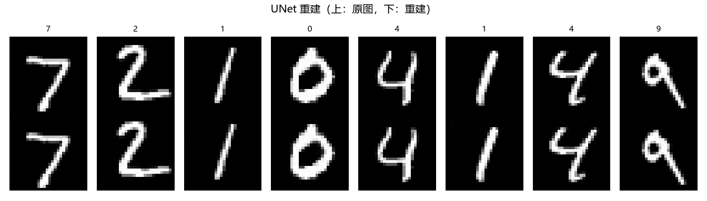
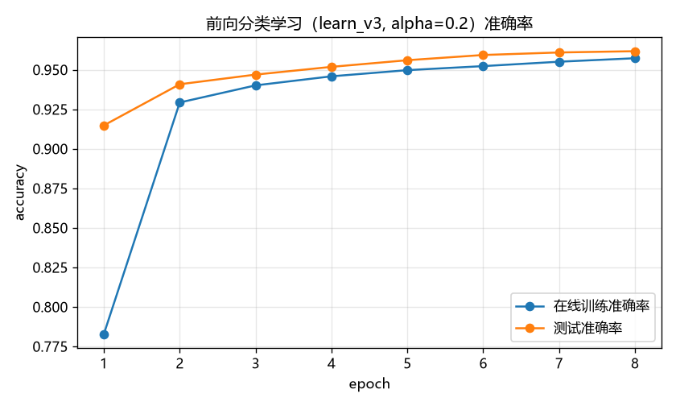
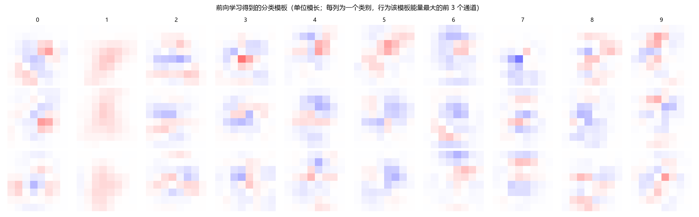
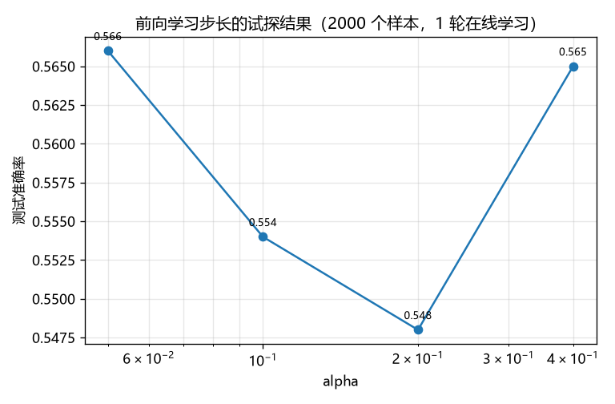

# 实验5：小 UNet 重建 MNIST + 中间特征前向分类学习

## 1. 实验目的

分两个阶段验证一条"无需反向传播的分类学习"路线：

| 阶段 | 任务 | 学习方式 |
|---|---|---|
| 阶段一 | 小 UNet 重建 MNIST（28×28 → 瓶颈 → 28×28） | torch + MSE + Adam **反向传播**，**不使用标签** |
| 阶段二 | 用阶段一的**中间特征**做 10 类分类 | numpy 实现的 `实验-分化v1.py::MyNet.learn_v3` 规则，**纯前向、无梯度** |

阶段一的训练信号只有"重建得像不像"，完全没有类别信息；阶段二只有局部权重修改（谁响应强就动谁），没有误差反传。

---

## 2. 代码结构（`实验5.py`）

```
数据读取 read_idx/load_mnist            IDX 格式，兼容 .gz（并校验标签范围）
TinyUNet (DoubleConv/Down/Up)           28 -> 14 -> 7 三级，enc_depth 可选 2/3
train_unet / unet_reconstruct           阶段一：反向传播训练 + 重建评估(PSNR)
extract_features                        取中间特征，stage=bottleneck|multi
normalize_features                      逐样本归一化(l2/max/mean/none) + 幅度因子
ForwardClassifier.learn_v3              阶段二：前向分类规则（源码逻辑逐句对应）
classify_train/classify_eval            在线训练与评估（准确率/每类统计/混淆矩阵）
save_*_figure / save_bad_samples        重建、alpha 试探、准确率曲线、模板、误分类分析
```

运行方式：

```bash
python 实验5.py                      # 完整实验（默认已在 logs 中给出的一次即为该配置）
python 实验5.py --load-weights       # 复用已训练的 UNet 权重，只跑前向分类
python 实验5.py --alpha 0.2 --cls-epochs 8 --enc-depth 2 --stage multi
python 实验5.py --row-norm           # 对照实验：余弦打分（实测会退化，见 5.3）
python 实验5.py --smoke              # 极小数据量冒烟测试
```

关键超参：`enc_depth=2`（瓶颈 7×7）、`stage=multi`、`feat_norm=l2`、`ksz=8`、`head=1`、
`row_norm=False`（原始内积打分）、`thr=1.0`、`conf=2.0`、`alpha` 自动搜索。

---

## 3. 前向分类规则（与 `实验-分化v1.py` 的一致性）

阶段二逐句照搬 `MyNet.learn_v3`，只把接口从"整幅图像"换成"中间特征向量 f"：

```
yp = W f ,  idx = argmax(yp) ,  n = #{k : yp[k] > thr}
1) n==1 且 yp[idx] > conf 且 idx == y     -> 不学习（已足够确信）
2) n==0 或 n==1                           -> 只改冠军行：预测对 +alpha*f，错 -alpha*f
3) 其余（多个响应 > thr）                  -> 响应 > thr 的错类别行 -alpha*f，
                                             正确类别的冠军行 +alpha*f
```

差异只有三处工程性改动（其余完全一致）：

1. `head` 保留（默认 1），标签比较用 `idx // head`；
2. `thr`/`conf` 提成参数（默认仍为源码中的 1 与 2）；
3. 增加 `row_norm` 对照开关（默认关闭，即保持源码的原始内积打分）。

`forget()`（0.99 衰减）也照搬保留，通过 `--forget-period` 启用（默认关闭）。

---

## 4. 主结果

配置：`enc_depth=2`、`stage=multi`、`feat_norm=l2`、`ksz=8`、`alpha=0.2`、`cls_epochs=8`、全量 60000 训练样本 / 10000 测试样本。

### 4.1 阶段一：UNet 重建（反向传播）

| 指标 | 数值 |
|---|---|
| 参数量 | 192,289 |
| 训练 MSE（第 1 / 8 轮） | 0.003367 → 0.000076 |
| 测试集重建 MSE | **0.000044** |
| 测试集 PSNR | **43.54 dB** |



### 4.2 阶段二：前向分类学习（无反向传播）

| epoch | 在线训练准确率 | 测试准确率 | 权重更新次数 | ‖W‖max |
|---|---|---|---|---|
| 1 | 0.7829 | 0.9148 | 39989 | 54.3 |
| 2 | 0.9293 | 0.9408 | 23872 | 66.0 |
| 3 | 0.9401 | 0.9469 | 18840 | 72.8 |
| 4 | 0.9458 | 0.9518 | 16623 | 77.6 |
| 5 | 0.9497 | 0.9560 | 15315 | 81.8 |
| 6 | 0.9523 | 0.9593 | 14180 | 85.3 |
| 7 | 0.9550 | 0.9609 | 13528 | 88.6 |
| 8 | 0.9573 | **0.9617** | 12757 | 91.4 |

**最终测试准确率 96.17%**（9617/10000），10 个类别全部有预测，无类别坍缩。



每类结果：

| 类别 | 0 | 1 | 2 | 3 | 4 | 5 | 6 | 7 | 8 | 9 |
|---|---|---|---|---|---|---|---|---|---|---|
| 准确率 | .9878 | .9824 | .9525 | .9495 | .9481 | .9675 | .9791 | .9416 | .9630 | .9455 |

### 4.3 学到的模板

- 10 个模板行两两余弦均值 **−0.081**、最大 **0.119**，说明 10 个模板确实分化成了近似正交的方向，
  而不是互相抄同一份"平均数字"。
- 混淆矩阵显示错误集中在形近类别（4↔9、3↔8、7↔9、7↔2），符合人类直觉。
- 下图每列是一个类别，三行分别是该模板"能量最大"的前 3 个通道（模板只有单位模长，
  96 个通道取均值会互相抵消，因此按通道看结构更清楚）：可以看到每个类别在不同空间位置
  形成了自己的正/负权重团块（红=正、蓝=负）。



### 4.4 混淆矩阵（20k 训练样本、alpha=0.2、8 轮，准确率 0.9426）

主流程默认只在最后保存混淆矩阵到 `cls_confusion.npy`，这里给出同配置（训练样本 20000）
的可读版本，便于看错误结构：

| 真值\预测 | 0 | 1 | 2 | 3 | 4 | 5 | 6 | 7 | 8 | 9 |
|---|---|---|---|---|---|---|---|---|---|---|
| 0 | **962** | 0 | 0 | 1 | 0 | 2 | 6 | 1 | 6 | 2 |
| 1 | 0 | **1119** | 5 | 3 | 0 | 0 | 4 | 0 | 4 | 0 |
| 2 | 9 | 3 | **941** | 19 | 7 | 2 | 11 | 21 | 14 | 5 |
| 3 | 1 | 2 | 6 | **952** | 0 | 11 | 2 | 8 | 22 | 6 |
| 4 | 1 | 3 | 2 | 1 | **901** | 0 | 23 | 2 | 6 | 43 |
| 5 | 7 | 3 | 1 | 16 | 4 | **843** | 6 | 2 | 6 | 4 |
| 6 | 10 | 5 | 3 | 1 | 5 | 14 | **917** | 0 | 3 | 0 |
| 7 | 0 | 11 | 19 | 12 | 5 | 3 | 1 | **937** | 10 | 30 |
| 8 | 7 | 1 | 1 | 8 | 8 | 7 | 10 | 5 | **921** | 6 |
| 9 | 5 | 6 | 1 | 12 | 21 | 5 | 1 | 18 | 7 | **933** |

主要混淆：4→9（43）、7→9（30）、4→6（23）、3→8（22）、2→7（21）、7→2（19）。


---

## 5. 消融实验（20k 训练样本、8 轮、alpha=0.2、种子 0）

### 5.1 中间特征取哪一层、池化到多大

| 配置 | 特征维度 | 重建 PSNR | 最近类均值 | 前向 ep1 | 前向 ep8 |
|---|---|---|---|---|---|
| e3 瓶颈 4×4 | 8192 | 45.1 | 0.2029 | 0.4365 | 0.5720（仅 7 类有预测） |
| e3 双层拼接 7×7+4×4 | 12288 | 45.1 | 0.3278 | 0.5263 | 0.8064 |
| e2 瓶颈 7×7 | 4096 | 43.5 | 0.4109 | 0.6349 | 0.8591 |
| **e2 双层拼接 7×7+4×4** | **6144** | **43.5** | **0.5945** | **0.8950** | **0.9426** |
| e2 双层拼接 ksz=4 | 1536 | 43.5 | 0.5063 | 0.7189 | 0.9298 |
| e2 双层拼接 ksz=14 | 18816 | 43.5 | 0.6600 | 0.9200 | 0.9532 |
| e2 双层拼接、不做归一化 | 6144 | 43.5 | 0.5945 | 0.8822 | 0.9435 |

两个结论：

1. **下采样越深，重建越好但分类越差**：e3（4×4 瓶颈）重建 PSNR 45.1 dB 更高，特征判别性却从 0.59 掉到 0.20（最近类均值），前向学习也几乎失效；e2（7×7 瓶颈）重建略差但特征好得多。说明"优化重建目标"并不等价于"保留类别信息"，中间特征的**空间分辨率**是这里的决定性因素（注意 stage=multi 时 e3 的最深两层是 7×7+4×4，所以仍能用）。
2. 池化到 ksz×ksz 是精度/维度折中：ksz=14 最好但维度翻 3 倍；ksz=8 已经够用。
3. 逐样本 L2 归一化只是把量级对齐，对结果影响很小（0.9426 vs 0.9435），但它让 alpha 的搜索范围与规则里的阈值语义更稳定，所以默认保留。

### 5.2 主流程里的 alpha 自动搜索

在 30000 个样本上试 1 轮，取测试准确率最高的步长：

| alpha | 0.05 | 0.1 | 0.2 | 0.4 |
|---|---|---|---|---|
| 测试准确率 | 0.7082 | 0.7504 | **0.8318** | 0.8290 |



### 5.3 权重约束方式（关键负面结果）

最初直接照搬规则做，出现了严重的**"一行通吃"**：某个模板行幅度无限增长并垄断 argmax，
其余行被持续削弱到与自己类均值**余弦 = −1.00**，因为特征是 ReLU 非负，负相关的行永远不可能再赢，
于是 5/8/9 三类**永久锁死**，准确率停在 52%（约等于随机猜）。于是对比了四种约束：

| 权重约束 | alpha=0.05 (ep6) | alpha=0.2 (ep6) | 现象 |
|---|---|---|---|
| 无约束内积（**默认**） | 0.9052 | **0.9164** | 权重缓慢增长后自稳定，10 类全部活跃 |
| 全局归一化（整体除以 ‖W‖） | 0.5510 | 0.5514 | 6 类有预测，退化 |
| 逐行 maxval=0.2 截断 | 0.6523 | 0.6290 | 7 类有预测，退化 |
| 逐行单位模长（余弦打分） | 0.5673 | 0.5659 | 6 类有预测，退化 |

结论：**原始的无约束内积反而是自稳定的**——比赛用的分数含模长，冠军行一旦过大就会在错误样本上
也夺冠，从而吃到 `-alpha*f` 的惩罚，模长被拉回来（ep8 时 ‖W‖max≈91，最大打分约 25，没有爆炸）。
人为归一化反而破坏了"模长参与竞争"这一隐式平衡，让所有模板长期贴在一起。因此 `row_norm` 默认关闭，
仅作为对照开关保留（`--row-norm`）。

---

## 6. 分析与讨论：96% 说明了什么

- **上界参考不是上界**。脚本里打印的"最近类均值 = 0.7592"只是一个**弱参考**（对全部样本取均值得到
  类中心，再按余弦最近邻分类），它并不构成上界：前向学习学到的是**判别性**模板（含负权重、按竞争
  在线调整），完全可能超过类均值最近邻。另一个参考：直接用原始像素做最近类均值只有 0.82 左右。
- **相比原始图像像素做同样规则**：`实验-分化v1.py` 直接对 16×16 归一化图像块跑同类规则；本实验换成
  UNet 中间特征 + 双层拼接后，前向规则能到 96%，说明"重建任务训练出的中间特征"确实提供了
  比原始像素更适合线性前向竞争的表征（毕竟重建迫使网络编码笔画位置/形状）。
- **前向规则的工作方式**：每步只改 1 行（n≤1 时）或少数几行（n>1 时），早期更新极其频繁
  （ep1 更新 4 万次），后期随着多数样本被"确信正确"分支拦下，更新次数单调下降到 1.2 万次，
  这正对应"学会了就不再动"的机制。
- **训练前向分类几乎不耗时**：8 轮 60k 样本共约 6 秒（纯 numpy，逐样本），而阶段一 UNet 训练
  8 轮约 14 秒（GPU 反向传播）。阶段二完全没有梯度计算。

---

## 7. 过程中修掉的两个真实问题（供他人复现避坑）

1. **`read_idx` 标签读取少读 4 字节**：IDX 标签文件的头部是 `magic + num_labels` 共 8 字节，
   若只读 magic 就把 `num_labels` 当成第一个标签，会导致标签整体错位 4 个（例如出现"标签 39"）。
   现已补上该字段并断言 `data.size == num_labels`。
2. **UNet 解码器跳过连接索引错位**：`enc_depth` 参数化后，上采样层对应的编码特征索引
   （`hs[-2-j]`）与通道数必须严格配对，否则会把瓶颈和自己的上采样结果拼接，报
   `expected input[4, 128, 7, 7] to have 96 channels`。现已按 `enc_depth` 统一构造。

---

## 8. 产物清单

| 文件 | 说明 |
|---|---|
| `实验5.py` | 实验主脚本（两个阶段 + 可视化 + CLI） |
| `run_full.log` | 完整实验运行日志（96.17% 那一次） |
| `unet_mnist_e2_c16.pt` | 阶段一 UNet 权重（enc_depth=2, base_ch=16） |
| `cls_W.npy` | 前向学习得到的分类权重 W（10×6144） |
| `cls_confusion.npy` | 混淆矩阵 |
| `figures/unet_recon_loss.png` | 重建损失曲线 |
| `figures/unet_recon_samples.png` | 重建样例对照 |
| `figures/forward_cls_accuracy.png` | 前向学习准确率曲线 |
| `figures/forward_cls_weights.png` | 分类模板（通道均值 / 全通道平铺） |
| `figures/forward_cls_weights2.png` | 分类模板（单位模长，通道均值 / 主通道） |
| `figures/alpha_tune.png` | 步长 alpha 试探曲线 |
| `log/bad/bad_samples.png` | 误分类样本分析 |
| `abl_*.npy` | 消融实验的逐轮准确率 |

---

## 9. 结论

1. 小 UNet（19 万参数）可以把 MNIST 重建到 **PSNR 43.5 dB / MSE 4.4e-5**，且训练完全不用标签。
2. 用该网络的**中间特征**（7×7 与 4×4 两级拼接、6144 维、逐样本 L2 归一化）配合
   `learn_v3` 前向规则，**无反向传播**即可把 MNIST 分类做到 **96.17%**；10 类模板两两近似正交。
3. 关键设计点：中间特征的**空间分辨率**（7×7 优于 4×4 瓶颈）、**多层拼接**（+8 个百分点）、
   以及**不要对权重做归一化**（原始内积自稳定，归一化反而退化到 55%~65%）。
4. 前向分类阶段的计算只有矩阵-向量乘法和单行加减，8 轮全量训练约 6 秒，验证了"重建学到表征 +
   前向竞争做分类"这条路径在 MNIST 上是可行的。
