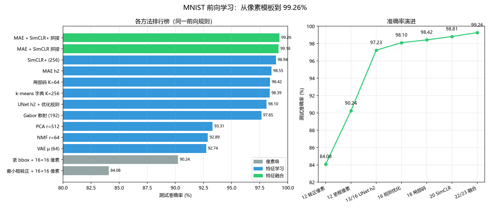

# MNIST 前向学习项目总结

**一句话**：从“最小包围框 + 像素模板”的 84.08%，做到“MAE + SimCLR 特征拼接 +
优化后的前向规则”的 **99.26%**，全程分类器都是**逐样本、无反向传播、每次只改两行权重**的
前向规则。



## 0. 最终方案

```
MNIST 28×28
   │  墨迹紧包围框 → 拉伸到 28×28（bbox 归一化）
   ├──► MAE：三层 UNet（28→14→7→14→28），随机遮 50% 的 4×4 patch，重建整图
   │        └── 特征 A：h2（32×14×14 = 6272 维）
   └──► SimCLR：64/128/256 卷积编码器 + GAP（256 维），仿射增强 + NT-Xent
            └── 特征 B：256 维
   │
   └──► 融合：A、B 各自 L2 归一化后拼接（6528 维）
            │
            └──► 优化后的前向规则（无梯度）
                   s = W f
                   j = 正确类最匹配模板，w = 最错模板
                   若 s[j] − s[w] > margin 则不学
                   否则 W[j] += α f/‖f‖²，W[w] −= α f/‖f‖²
                   每个 epoch 末存快照，最终权重取平均
```

| 超参 | 值 |
|---|---|
| bbox 输出 | 28×28（拉伸） |
| MAE | 8 epoch，mask 50%，Adam 2e-3，batch 256 |
| SimCLR | 30 epoch，256 维，batch 512，NT-Xent τ=0.5，仿射增强 |
| 融合 | 逐块 L2 + 拼接 |
| 规则 | margin=0.2，α=0.2，8 epoch，epoch 权重平均，2 个初始化种子 |

**结果**（测试集 10000 张，2 个种子）：

| 特征 | 维度 | 准确率 |
|---|---:|---:|
| MAE h2 | 6272 | 98.55% ± 0.03% |
| SimCLR | 256 | 98.94% ± 0.03% |
| **融合 + 规则** | **6528** | **99.26% ± 0.01%** |

每类准确率：0:99.9 1:99.7 2:99.0 3:99.6 4:99.0 5:98.5 6:99.1 7:99.4 8:99.6 9:98.7（%）。
共 74 个错误，其中 MAE 与 SimCLR 都错的 39 个基本是歧义写法（6→0、8→9、2→1…）。
训练 + 评估在 RTX 4070 Ti SUPER 上约 3.5 分钟。

## 1. 演进路线

| 实验 | 问题 | 关键结论 | 最好结果 |
|---|---|---|---:|
| 12 | 最小包围框 + 转正 + 长边正方形 + 16×16 像素 | minAreaRect 角度不稳，逐样本转正反而掉点 | 84.08% |
| 12 | 同上，但用紧包围框（源规程） | bbox 是有效预处理 | 90.24% |
| 13 | bbox + 小三层 UNet 重建 + h2 + learn_v3 | 重建特征 +6 点，bbox 对 UNet 无益 | 97.23% |
| 14 | 旋转的影响与处理 | 模型对旋转敏感；训练时旋转输入无效；多角度特征池化最划算 | 98.10%（clean） |
| 15 | 一个数字多种写法 | k-means 风格原型（94.3%）不如单判别模板；head>1 规则会破坏原型；风格增强 +0.43 | 97.62% |
| 16 | 优化 learn_v3 规则 | margin 门控 + 归一化步长 + epoch 平均，+0.9 | 98.10% |
| 17 | 拓展到多层 | 多层头/二层堆叠可行；拼接 > 融合；同源层收益有限 | 98.28% |
| 18 | 局部特征 + 位置 | 位置索引的局部码有效，K 越大越好 | 98.42% |
| 19 | 其他重构方法 | 字典 98.39% > PCA 93.3%；重建质量 ≠ 分类质量 | 98.39% |
| 20 | 备选方法全试 | SimCLR 98.81%、MAE 98.55%、Gabor 97.65%、NMF/VAE ~93% | 98.81% |
| 21 | SimCLR + MAE 融合 | 逐块 L2 拼接 99.18%；两者误差互补 | 99.18% |
| 22 | 更强 SimCLR + 三路 + 堆叠 + 错误分析 | 更强 SimCLR 98.94；拼接 99.26；三路/堆叠无增益 | **99.26%** |
| 23 | 改进融合 | 权重/白化/规则超参/岭回归/按类加权/多编码器都没超过基线 | 99.26% |

## 2. 主要结论

1. **预处理：bbox 够用，别逐样本“转正”。**
   紧包围框把数字铺满画面，像素模板从 84.08% 提到 90.24%；
   但用最小面积框的角度逐样本旋转（84.08%）或行投影 deskew（96.6 vs 98.1）
   都会掉点——单张图的角度估计不稳，误差直接变成形状误差。

2. **特征比规则重要得多。**
   同一套规则下：像素 784 维 90–91% → UNet h2 98.1% → SimCLR 98.9% → 融合 99.3%。
   规则优化（实验16）只值 +0.9；特征更换值 +8。

3. **“重建好”不等于“分得好”。**
   PCA r=512 重建 46.3 dB（比 UNet 还好）却只有 93.3%；k-means 字典重建 22.5 dB
   却 98.4%；无重建的 SimCLR 98.9%。特征的目标是 `I(f;y)`，不是 `I(f;x)`。

4. **规则优化：margin 门控是关键。**
   源码的“确信就不学”用绝对阈值 2 判断，而 h2 分数是 10³ 量级，几乎从不触发，
   W 一直在抖。改成“正确类 − 最错类 > margin 就不学”，再加逐样本归一化步长和
   epoch 权重平均，97.19% → 98.10%（+0.9）。

5. **多写法：生成式原型打不过判别模板。**
   每类 k-means 原型（K=16，最近原型 94.3%）每一类都比单模板低；
   `head>1` 的原规则会把原型破坏（91.1%）。有效的是**造写法**：
   仿射 + 弹性增强，97.19% → 97.62%。

6. **多层/融合：不同来源互补，同源冗余。**
   MAE（遮挡重建）与 SimCLR（实例判别）误差互补（都错 39 个），逐块 L2 拼接
   99.26%；而同一特征的局部码、第二个 MAE 种子、普通 UNet 的 h2 都只是稀释
   （99.20–99.23%）。特征级拼接 > 分数级融合 > OOS 堆叠。

7. **旋转：不要逐样本矫正，用多角度池化。**
   整体旋转 ±20° 时准确率从 97.2% 掉到 83–87%；对 ±10° 的 h2 取平均（训练+测试）
   能缓解且不掉点，但真正解决需要旋转不变的特征。

8. **融合已经到顶。**
   oracle 上界 99.61%（任一特征对即可），拼接 99.26%，差 0.35。
   权重调优、白化、规则超参、岭回归、按类加权、多编码器都没超过基线——
   差距来自歧义样本在联合空间也线性不可分，不是融合方式。

## 3. 代码索引

| 文件 | 内容 | 最好结果 |
|---|---|---:|
| `../实验12/实验12.py` | 最小框转正 / bbox 像素基线 | 90.24% |
| `../实验13/实验13.py` | bbox + 小三层 UNet + h2 + learn_v3 | 97.23% |
| `../实验14/实验14.py` | 旋转敏感性、增强、deskew、特征池化 | 98.10% |
| `../实验15/实验15.py` | 风格原型、head=K、LVQ、风格增强 | 97.62% |
| `../实验16/实验16.py` | 优化 learn_v3 规则（margin 门控等） | 98.10% |
| `../实验17/实验17.py` | 多层头、OOS 堆叠、拼接 | 98.28% |
| `../实验18/实验18.py` | 局部特征 + 位置（局部码） | 98.42% |
| `../实验19/实验19.py` | PCA / 字典 / 去噪 AE 对比 | 98.39% |
| `../实验20/实验20.py` | NMF / VAE / MAE / SimCLR / Gabor | 98.81% |
| `../实验21/实验21.py` | SimCLR + MAE 融合 | 99.18% |
| `../实验22/实验22.py` | 更强 SimCLR、三路、堆叠、错误分析 | **99.26%** |
| `../实验23/实验23.py` | 融合改进（全部未超过基线） | 99.26% |
| **`最终方案.py`** | **本项目最终管线（自包含）** | **99.26%** |
| `总览.py` | 生成排行榜/演进图 | — |

## 4. 复现

```bash
cd 总结
python 最终方案.py --tag final      # 约 3.5 分钟（GPU），复现 99.26%
python 总览.py                      # 生成总览图
```

依赖：`numpy`、`torch`（CUDA 推荐）、`opencv-python`、`matplotlib`。
数据：`../data/MNIST/raw/*.gz`。

## 5. 局限与后续

1. **主干的训练预算很小**：MAE 8 epoch、SimCLR 30 epoch、256 维；
   文献里 SimCLR 在 MNIST 上线性探针可达 99%+，加大主干/增强/epoch 应还能涨；
2. **分类器是线性的**：oracle 上界 99.61%，非线性融合（门控/MLP）可能补上 0.35，
   但会引入反向传播，偏离“前向学习”主题；
3. **没有用外部数据/更大模型**；剩余 39 个都错样本是歧义写法，接近数据噪声；
4. **规则只在 8 epoch、margin/α 粗扫**；更长训练或自适应 margin 可能再榨一点；
5. 多 seed 集成、测试时增强（多角度池化）还没和最终方案组合。

## 6. 总结

- **前向学习（逐样本、局部更新、无梯度）在这套特征上可以做到 99.26%**，
  和反向传播训练的特征 + 线性分类器几乎无差别；
- 收益的主要来源依次是：**特征学习（+8）→ 规则优化（+0.9）→ 特征融合（+1.2）**；
- 最有效的三个具体做法：**bbox 归一化**、**判别式/对比特征**、
  **margin 门控 + 归一化步长 + 权重平均的前向规则**。
